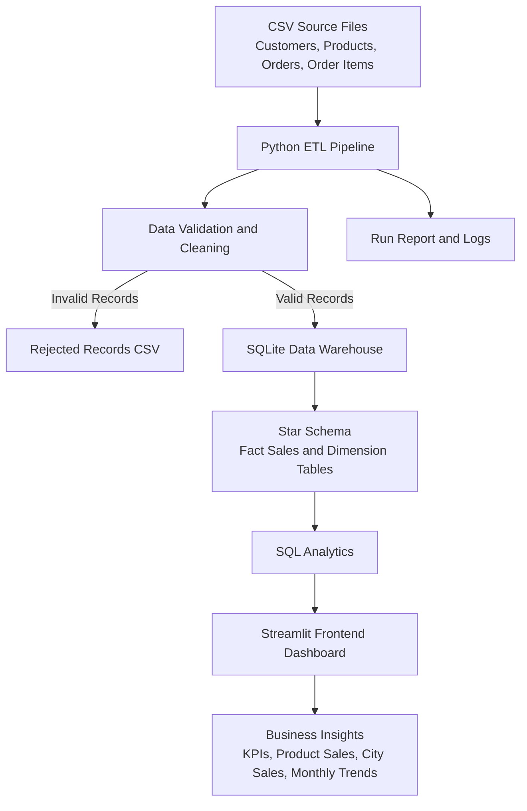

# Retail Sales Analytics Warehouse
## System Architecture Document

### 1. Project Overview

The Retail Sales Analytics Warehouse is designed to process retail sales data, maintain structured data in a SQLite database, and display business insights through an interactive Streamlit dashboard.

### 2. Architecture Diagram



### 3. Technology Stack

| Component | Technology |
|---|---|
| Programming Language | Python |
| Data Processing | Pandas |
| Database | SQLite |
| Data Analytics | SQL |
| Dashboard | Streamlit |
| Visualization | Streamlit Charts |
| Testing | Python unittest |
| Source Data | CSV files |

### 4. Backend Architecture

The backend is responsible for:

- Reading retail data from CSV files.
- Validating records and checking data quality.
- Rejecting invalid records and saving them separately.
- Creating and loading dimension and fact tables.
- Running analytical SQL queries.
- Generating execution reports and logs.
- Running automated unit tests.

### 5. Database Design

The warehouse uses a Star Schema.

**Dimension Tables:**
- dim_customer: Customer information.
- dim_product: Product information.
- dim_date: Date-related information.

**Fact Table:**
- fact_sales: Sales transactions, quantities, prices, discounts and revenue.

**Fact Table Grain:** One row represents one product line in one customer order.

### 6. Frontend Architecture

The frontend is developed using Streamlit.

It connects to the SQLite database and presents:

- Total Revenue
- Total Orders
- Total Units Sold
- Total Customers
- Top 10 Products by Revenue
- City-wise Revenue
- Monthly Revenue Trend
- Top Products Details

### 7. Data Flow

1. CSV files provide the source retail data.
2. The Python ETL pipeline reads the source files.
3. Data validation checks records and identifies invalid data.
4. Valid records are loaded into SQLite dimension and fact tables.
5. Invalid records are stored in rejected_records.csv.
6. SQL queries calculate business metrics.
7. Streamlit displays the results through interactive dashboard components.

### 8. Data Quality and Testing

The project includes automated tests for:

- Pipeline execution.
- Empty input files.
- Invalid and duplicate records.
- Sales reconciliation.

The pipeline also generates a run report and rejected-record file.

### 9. Execution

Run the backend pipeline from the backend directory:

```powershell
python .\src\pipeline.py
```

Run the frontend dashboard from the project root:

```powershell
python -m streamlit run frontend/app.py
```

Run backend tests from the backend directory:

```powershell
python -m unittest discover -s tests -v
```

### 10. Current Design Limitation

The current pipeline uses a full-refresh loading strategy. It rebuilds the warehouse during each successful run rather than processing only new or changed records.

### 11. Conclusion

The solution provides a structured retail data warehouse with data validation, automated testing, SQL-based analytics and a separate Streamlit dashboard for business reporting.
